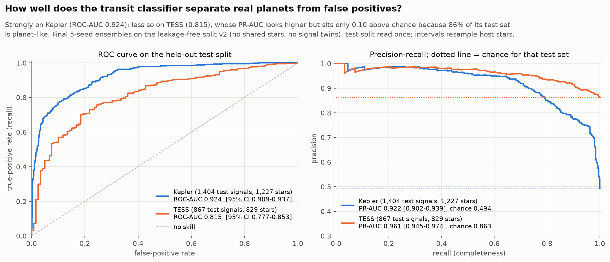
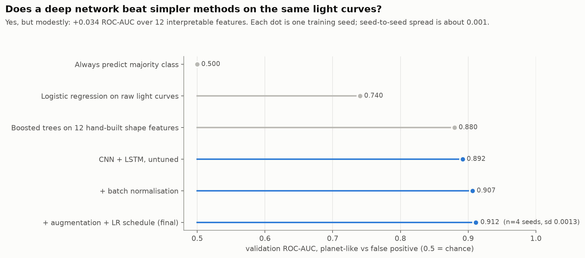
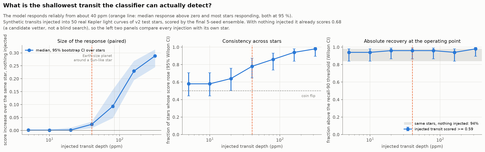
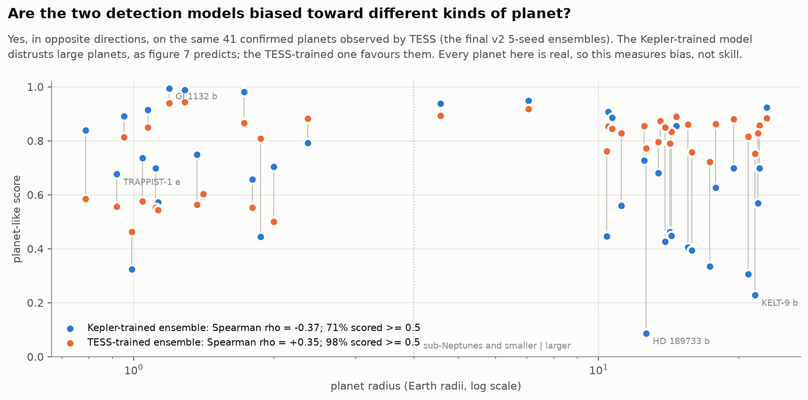

# Transit-candidate vetting → JWST atmospheres → follow-up prioritisation

A three-stage pipeline:
- **Stage A** classifies Kepler and TESS *transit candidates* (KOIs/TOIs) as planet-like or false
  positive from their phase-folded light curves. It is a **vetter of signals a transit search has
  already found, not a transit search**: with nothing injected, it scores most random folds as
  planet-like (`eda/STAGE_A_LEVEL2_RESULTS.md` §6e).
- **Stage B** asks what JWST transmission spectra can show about the gases that would indicate
  habitability:
  - molecule classification on the real spectra (a negative result with 13 planets);
  - physics-normalised analysis and rocky-planet detection limits;
  - a classifier trained **only on simulated spectra** (petitRADTRANS, real JWST noise) that
    recognises **CH₄** in the real spectra of planets it never saw (planet-level ROC-AUC 1.00,
    p = 0.007; a gas-blind control scores 0.40). It was confirmed in a **pre-registered test on 29
    new JWST planets**: ROC-AUC 0.97 (CI 0.88–1.00, p = 0.0003; control 0.71). It also holds on the
    strongest-feature half (0.97 vs 0.70), where feature strength cannot stand in for CH₄, and with an
    independent second training grid (0.98);
  - a **detectability forecast**, with a noise model calibrated and validated on 117 real
    single-transit JWST spectra, of how many transits would detect CO₂, CH₄ and O₃ on each
    habitable-zone target. Full Bayesian retrievals refine it: a real analysis needs 1.4× (CO₂) to
    2.2× (CH₄) the forecast transits;
  - a re-analysis of the **real TRAPPIST-1 e JWST spectra**: no credible atmosphere detection (the
    apparent signal sits in two contaminated visits), and a CO₂-rich Archean-like atmosphere is
    disfavoured. Null tests on airless TRAPPIST-1 b, c and d find nothing.
- **Stage C** ranks 44 transiting planets for transmission follow-up, with uncertainty, by three criteria:
  - habitable-zone membership (Kopparapu et al. 2014);
  - being terrestrial-size *and* able to keep an atmosphere. This uses the cosmic shoreline of
    Zahnle & Catling 2017, checked against the 13 JWST/Spitzer rocky planets with no thick
    atmosphere, all of which it places on the airless side;
  - the TSM (Kempton et al. 2018).
  It is a ranking with stated weights. **Nothing in this project computes a probability of
  habitability**, and being in the habitable zone is not being habitable.

**Start here:** the result write-ups in [`eda/`](eda/) are the findings. Everything else
is the machinery that produced them.

| report | what it answers |
|---|---|
| [`eda/STAGE_A_V2_FINAL_RESULTS.md`](eda/STAGE_A_V2_FINAL_RESULTS.md) | **the final transit-vetting result**: leakage-free split, test read once |
| [`eda/STAGE_A_LEVEL2_RESULTS.md`](eda/STAGE_A_LEVEL2_RESULTS.md) | the transit classifier: baselines, tuning, ablation, failure analysis |
| [`eda/TESS_AND_CROSS_MISSION_RESULTS.md`](eda/TESS_AND_CROSS_MISSION_RESULTS.md) | the TESS model, and transfer between missions |
| [`eda/STAGE_B_RESULTS.md`](eda/STAGE_B_RESULTS.md) + [`eda/STAGE_B_LEVEL2_RESULTS.md`](eda/STAGE_B_LEVEL2_RESULTS.md) | molecule classification, then physics-informed analysis |
| [`eda/STAGE_B_LEVEL3_RESULTS.md`](eda/STAGE_B_LEVEL3_RESULTS.md) | a molecule classifier trained only on simulated spectra, tested on the real ones |
| [`eda/METHANE_EXTENSION_RESULTS.md`](eda/METHANE_EXTENSION_RESULTS.md) | the pre-registered test of that classifier on 19 new JWST planets, and its calibration |
| [`eda/FORECAST_RESULTS.md`](eda/FORECAST_RESULTS.md) | JWST transits needed to detect CO₂, CH₄, O₃ on each habitable-zone target |
| [`eda/STAGE_C_RESULTS.md`](eda/STAGE_C_RESULTS.md) | the follow-up priority table: habitable zone, size, TSM, with uncertainty |

[`run_log.txt`](run_log.txt) is the running record: every build, every result, every bug found
and what it changed. It is the honest history, including the things that went wrong.

**Reproducing it:** the results above need no download at all — they are committed here. To
re-run the modelling, fetch the views from release [`v2.0-views`](https://github.com/WoolyBro/Exoplanet_Detection/releases/tag/v2.0-views) (~510 MB, split v2 with the error channel, plus K2, DR25 and vetter v3) and
see [Running this without a 30-hour download](#running-this-without-a-30-hour-download).

---

## Headline numbers

Final evaluation on the **leakage-free split v2** (no shared stars, no cross-split signal twins),
with the model chosen on validation by a pre-registered rule and the test set read once
([`eda/STAGE_A_V2_FINAL_RESULTS.md`](eda/STAGE_A_V2_FINAL_RESULTS.md)):

| | Kepler | TESS |
|---|---|---|
| final model | 5-seed CNN+BiLSTM ensemble, flux-error channel | 5-seed dual-CNN ensemble |
| test ROC-AUC (95 % star bootstrap) | **0.924** [0.909, 0.937] | 0.815 [0.777, 0.853] |
| confirmed vs false positive only | **0.971** | 0.900 |
| lift over the base rate (PR-AUC) | **+0.428** | +0.098 |
| gain over a transit-shape GBM, same split | +0.034 [0.022, 0.045] | +0.094 [0.055, 0.136] |
| precision at the validation-fixed 90 %-recall threshold | 0.792 | 0.915 |
| vs published vetters, same test KOIs (confirmed vs FP) | ≈ AstroNet (ΔAUC +0.001); below ExoMiner (−0.019), which uses extra diagnostics | — |
| calibrated (Platt, fitted on validation) test ECE | 0.023 | 0.018 |
| **K2, a mission neither model saw** (pre-registered, read once) | **0.863** [0.840, 0.884]; confirmed vs FP 0.954 | 0.843 [0.816, 0.871] |
| **Kepler DR25 simulated data** (stars never seen; vs Robovetter on the same signals) | injected planets kept **0.935** vs 0.869; systematics false alarms rejected **0.760** vs 0.992 | — |

**Added 2026-10-18/19, each pre-registered and read once** (all outcomes in [`eda/PREREGISTRATION_SCOREBOARD.md`](eda/PREREGISTRATION_SCOREBOARD.md): 47 expectations, 33 held, 14 failed):

| Result | Number | Write-up |
|---|---|---|
| **Vetter v3** (Kepler; + real false alarms + 27 pipeline measurements) | equal to ExoMiner on the Kepler test (0.9961 vs 0.9963); fresh false alarms rejected 0.991 (v2 0.704); neighbouring-star FPs caught 0.80 (v2 0.49); faint off-target/EB simulations still lag the Robovetter | [`eda/VETTER_V3_RESULTS.md`](eda/VETTER_V3_RESULTS.md) |
| **How the vetter decides** | seed spread flags errors (abstain on half: error 16.8 % → 5.1 %); the survey prior is causal through S/N; S/N-balanced training removes two-thirds of it, at a K2 cost | [`eda/VETTER_MECHANISMS_RESULTS.md`](eda/VETTER_MECHANISMS_RESULTS.md) |
| **CO₂ detector on 34 real JWST planets** | 1-D CNN 0.996, GBM 0.982; strong-feature half 0.98 / 0.94 vs gas-blind control 0.67; masking the 4.3 µm band removes the skill | [`eda/CO2_EXTENSION_RESULTS.md`](eda/CO2_EXTENSION_RESULTS.md) |
| **Habitable-zone retrievals** | TRAPPIST-1 f ln B = −0.70, LHS 1140 b −0.90: no atmosphere credited; H₂ envelopes disfavoured | [`eda/RETRIEVAL_HZ_RESULTS.md`](eda/RETRIEVAL_HZ_RESULTS.md) |
| **Fitted habitability factor** | retention fitted to 20 rocky planets (P(β < 0) = 0.99); Sobol robust core of 7; 15 vetted HZ candidates | [`eda/STAGE_C_RESULTS.md`](eda/STAGE_C_RESULTS.md) §2c–3c |

The earlier numbers (Kepler 0.9158, TESS 0.7843) came from split v1. That split leaked: 301 of
1,406 Kepler test KOIs had a signal twin in another split. They are kept in
`eda/STAGE_A_LEVEL2_RESULTS.md` as history.

The lift column matters more than the raw score: TESS's test set is 86 % planet-like, so a
PR-AUC of 0.95 there is barely above guessing, while Kepler's is a genuine result. This is
explained wherever those numbers appear.

---

## Results in figures

The statistical figures (01–12 from one script, 13–16 from their analyses), each titled by the question it answers and carrying 95 %
intervals, are in **[`figures/`](figures/)** and regenerate with `python figures/make_figures.py`.
The Stage A figures show the final v2 ensembles and their single test read (regenerated 2026-10-18).
Four that carry the main argument:

**How well does the transit classifier separate real planets from false positives?**


**Does a deep network beat simpler methods on the same light curves?**


**What is the shallowest transit the classifier can actually detect?**


**Are the two detection models biased toward different kinds of planet?**


**[See all sixteen figures, with sources and interpretation &rarr;](figures/README.md)**

---

## Layout

Folders are named for the stage they serve. The mentor-supplied data pack is kept entirely
separate and is never written to.

```
exoplanet_research_data/     ← MENTOR'S PACK. Read-only, never modified by any script here.
                               Not in this repository (not ours to redistribute).

data_manifest.py             ← the gate: every script loads its data through this, so every
preprocessing_pipeline.py      input is declared in one place rather than opened ad hoc
split_catalogs.py            ← star-grouped train/val/test splits (read, never recomputed)
research_log.py              ← shared logging used by the pipeline scripts

catalog_preparation/         ← Stage 1: stellar host de-duplication
stage_a_transit_model/       ← Stage A: the CNN+LSTM transit classifier and every analysis of it
stage_b_atmospheres/         ← Stage B: JWST spectra → molecules (Levels 1–3) and the gas-detectability forecast
stage_b_rocky_benchmark/     ← Stage B: rocky-planet detection limits from the Zenodo compilation
stage_c_priority_fusion/     ← Stage C: follow-up priority (habitable zone, size, TSM) with uncertainty
stage_d_habitability/        ← PyATMOS / INARA exploration only; no model (30 INARA rows, no spectra)
tools/                       ← operational scripts (status, cache pruning, resumable builds)

figures/                     ← the statistical figures + the script that makes them
eda/                         ← the written reports (.md) and diagnostic plots
outputs/                     ← result tables per stage
splits/                      ← the split definitions - results are not reproducible without these
detection_views/             ← 15,185 split views (.npz: 9,394 Kepler + 5,791 TESS), plus the 41
                               Stage C target views and per-build indexes/logs (15,317 files in
                               all). Regenerable; not in the repository.
detection_views_err/         ← the same splits rebuilt with a per-bin flux-error channel
                               (tools/rebuild_with_errors.py). Depth channel identical; adds
                               global_err / local_err. Not in the repository.
```

### Stage A — `stage_a_transit_model/`

| file | role |
|---|---|
| `cnn_lstm.py` | the model, training loop, metrics. `--mission Kepler\|TESS`, `--arch` for the ablation |
| `baselines.py` | majority / logistic / 12 interpretable shape features — **run before believing the CNN** |
| `sweep.py` | the 23-run hyperparameter and architecture sweep, resumable |
| `failure_analysis.py` | which false positives fool it, against the Kepler FP flags |
| `error_buckets.py` | false negatives split into undetectable / noise-dominated / genuine |
| `embeddings.py` | t-SNE **and** a measured separability check (the picture is not the evidence) |
| `cross_mission.py` | every model on every mission's test set |
| `final_eval.py` | the single held-out test evaluation |
| `calibrate.py` | post-hoc probability calibration (Platt/isotonic, chosen and fitted on validation) |
| `make_figures.py` | the summary figure |

---

## Running this without a 30-hour download

The training inputs are 15,185 view files (~150 MB zipped) distilled from about **120 GB** of
photometry. That 120 GB was streamed and discarded star by star as the views were written, so
it was never stored — but rebuilding the views from scratch means downloading it again, which
takes roughly 30 hours. Nobody should have to do that to review the work. Three ways in,
cheapest first:

### 1. Read it — no download at all
Everything needed to check the analysis is already in this repository: the reports in
[`eda/`](eda/) contain every number, the figures, the result tables in `outputs/`, and
[`run_log.txt`](run_log.txt). `git clone` is 35 MB.

### 2. Run it on the committed sample — instant
[`detection_views_sample/`](detection_views_sample/) holds 252 real views (2.4 MB), 14 per
class per split, committed to this repository. Enough to run everything end to end:

```bash
pip install -r requirements.txt

python stage_a_transit_model/baselines.py \
    --train-views detection_views_sample/kepler_train \
    --val-views   detection_views_sample/kepler_val

python stage_a_transit_model/cnn_lstm.py --epochs 3 \
    --train-views detection_views_sample/kepler_train \
    --val-views   detection_views_sample/kepler_val
```

**These runs are smoke tests, not results.** 42 rows per split cannot reproduce a 0.9158
ROC-AUC, and the printed numbers should be read as "the pipeline works", nothing more. Rebuild
the sample with `python tools/make_sample_views.py`.

**The complete, ordered run sheet** covers split v2, the final evaluation, the K2 blind test, atmospheres, the forecast, the retrievals and the figures, with both environments (`environment-prt.yml` for petitRADTRANS). It is **[`REPRODUCE.md`](REPRODUCE.md)**. The subsections below are the quick paths into it.

### 3. Reproduce the real numbers — the view releases
The views are published as release assets, because tens of thousands of binary files do not belong in git history.

- **[`v2.0-views`](https://github.com/WoolyBro/Exoplanet_Detection/releases/tag/v2.0-views)** (~510 MB, used by every final result).
  - One archive per folder: split-v2 Kepler and TESS (with the flux-error channel), K2 (EVEREST and K2SFF), the DR25 benchmark, and the vetter v3 NTP and fresh-simulation sets.
  - Fetch only what you need: Kepler alone is `views_err_kepler_{train,val,test}.zip` (112 + 24 + 24 MB).
  - `VIEWS_ERR_MANIFEST.json` gives each archive's view count and SHA-256.

  ```bash
  gh release download v2.0-views --repo WoolyBro/Exoplanet_Detection --pattern 'views_err_kepler_*'   # or use the release page
  for z in views_err_*.zip; do unzip -o -q "$z"; done                                     # creates detection_views_err/
  python tools/make_v2_views.py                                                          # split-v2 layout, detection_views_v2/
  ```

- **[`v1.0-views`](https://github.com/WoolyBro/Exoplanet_Detection/releases/tag/v1.0-views)** (~150 MB). The split-v1 views behind the history section below. Split v1 leaked through signal twins, so it is not used for the final numbers.

**Quickest check — no training at all.** Both final checkpoints are committed, so the reported
test numbers can be regenerated directly from the selected artefact:

```bash
python stage_a_transit_model/final_eval.py --run stage_a_transit_model/runs/bn_aug_sched
```

To re-run the modelling itself, every command below reproduces the reported figures:

```bash
python stage_a_transit_model/baselines.py
python stage_a_transit_model/cnn_lstm.py --batchnorm --augment --scheduler
python stage_a_transit_model/sweep.py            # v1 sweep (history); the final v2 sweep is in REPRODUCE.md
python stage_a_transit_model/cross_mission.py
python stage_b_atmospheres/stage_b_pipeline.py        # also needs the research pack (spectra)
python stage_b_atmospheres/stage_b_level2.py
python stage_c_priority_fusion/build_priority_table.py  # also needs the research pack (pscomppars)
python stage_b_atmospheres/noise_model.py              # JWST noise calibration (research pack)
```

Stage B Level 3 and the forecast compute spectra with petitRADTRANS, which compiles Fortran and so
runs in its own environment (`~/micromamba/envs/prt`, Python 3.12, opacities in
`~/petitRADTRANS/input_data`, 1.7 GB):

```bash
~/micromamba/envs/prt/bin/python stage_b_atmospheres/synthetic_grid.py --n 3000 --workers 3   # ~2.2 GB RAM per worker
python stage_b_atmospheres/train_synthetic_classifier.py
python stage_b_atmospheres/methane_extension.py      # pre-registered test; refuses to run if the frozen labels changed
python stage_b_atmospheres/methane_round2.py         # round 2: full-text labels + second grid (outputs/stage_b_synthetic_seed2)
~/micromamba/envs/prt/bin/python stage_b_atmospheres/detectability_forecast.py
```

The first four commands need only this repository plus the view bundle. The last three also read
the mentor's `exoplanet_research_data/` pack, which is not redistributed here (see
[Data handling](#data-handling)); without it those three exit with a missing-file error. Stage D
(`stage_d_habitability/`) needs external INARA/PyATMOS data that is not in this repository; point
the environment variable `EXO_EXTERNAL_DATA` at it (default: the original `D:/Files`).

**Tests:** `python -m pytest tests` (45 tests: folding and view construction, the error channel,
both splits' leakage guarantees, the data manifest, the habitable-zone / TSM physics against
published values including mass upper limits, the forecast's noise scaling and transit-count
solver, and the frozen methane labels and leakage-free calibration). They need the split files and, for the manifest test, nothing else.

### 4. Rebuild the views from the archives — the 30 hours
Only needed to verify the view construction itself, not the modelling:

```bash
python preprocessing_pipeline.py build-split train --discard-raw --s3
python preprocessing_pipeline.py build-split train --mission TESS --discard-raw --s3
```

`--discard-raw` deletes each star's raw photometry once its views are written, so peak disk
stays near 1 GB instead of 120 GB. Builds checkpoint per star and resume if interrupted;
`python tools/status.py` reports progress and time remaining.

---

## Things a reader should know before trusting anything here

These are in the reports too, but they are the load-bearing caveats:

1. **Both v2 test sets are spent** (read once on 2026-10-18; guard file
   `stage_a_transit_model/runs/v2_final/TEST_READ.json`). The v1 test sets were spent earlier.
   Any further tuning has to go back to validation.
2. **Neither vetting model is unbiased, and their biases are opposite.** On the same 41
   confirmed planets, the final Kepler ensemble's score falls with planet radius (Spearman −0.37)
   and the TESS ensemble's rises (+0.35). The v1 single models gave −0.57 and +0.30.
   - The cause is in the training data. Kepler's v2 training split makes transits deeper than 10,000 ppm 94 % likely to be false positives; TESS's makes them 12 %.
   - This is measured, not assumed, and it is why the priority table carries both columns.
3. **The TESS build has a class-dependent yield** — 55.9 % of false positives survived the
   ephemeris-reliability check against 88.7 % of confirmed planets. That is selection bias, not
   just imbalance, and class weights do not fix it.
4. **Stage C ranks for follow-up; it does not assess habitability.** Habitable-zone membership is
   a statement about received flux. The ranking (rebuilt 2026-10-17) uses published physics with
   uncertainty, excludes the 10 planets that do not transit, and no longer uses the Stage B
   molecule model, which has no skill. See `eda/STAGE_C_RESULTS.md` §4 for what was wrong before.
5. **The vetter is a vetter, not a search or a false-alarm filter, and it cannot see centroids.**
   - Folding a star at an arbitrary period already scores a median 0.68. It must be run on signals a pipeline has already detected; it responds to injected transits from 40 ppm.
   - On Kepler's simulated data it lets through 24 % of systematics-born false alarms, against 0.8 % for the Robovetter, mostly long-period ones. It was trained on KOIs, which had already passed that triage.
   - On raw TCEs it needs a false-alarm filter in front.
   - False positives whose only warning sign is light from a neighbouring star are rejected 49 % of the time, against 95 % for eclipsing binaries (`figures/09`).
   - That gap is where ExoMiner, which reads centroid diagnostics, beats it.
6. **`stage_d_habitability/` is exploration, not a result.** No habitability model was trained:
   30 INARA rows with no spectra, and a composition-derived label would leak by construction.
7. **The raw planet-like score is a ranking, not a probability.** On test, the raw Kepler ensemble
   overstates mid-range scores and the TESS ensemble understates them (ECE 0.078 and 0.144).
   - Read it as a probability only after the Platt map fitted on validation (`calibrated_score` in `runs/v2_final/*_test_predictions.csv`).
   - With the map, test ECE is 0.023 (Kepler) and 0.018 (TESS), and the Brier score is 0.110 and 0.098.
8. **The gas forecast gives lower bounds under stated scenarios.** It uses a matched filter with a
   known template. Stellar contamination enters as linear spot/facula templates plus visit-varying
   structure calibrated on TRAPPIST-1's 8 real PRISM transits (`eda/FORECAST_RESULTS.md` §4e). On K2-18 b it is ~1.4–1.9× optimistic in
   S/N against the published detections. It says how hard a gas *would* be to detect, never
   that a planet has it. The simulated-spectra classifier shows real skill for CH₄ only; its
   H₂O/CO₂/CO scores are matched by a gas-blind control. Its CH₄ test set is 38 labelled planets,
   and its probabilities are only roughly calibrated (Brier 0.110 vs 0.235 base rate; Platt scaling
   did not improve them).

---

## Data handling

[`DATA_BOUNDARY.md`](DATA_BOUNDARY.md) has the full rules. In short: the mentor's pack is
treated as read-only, every input is declared in `data_manifest.py` rather than opened ad hoc,
and splits are read from `splits/` and never recomputed. Splits are grouped by star, so no
light curve from one target can appear in two folds.
