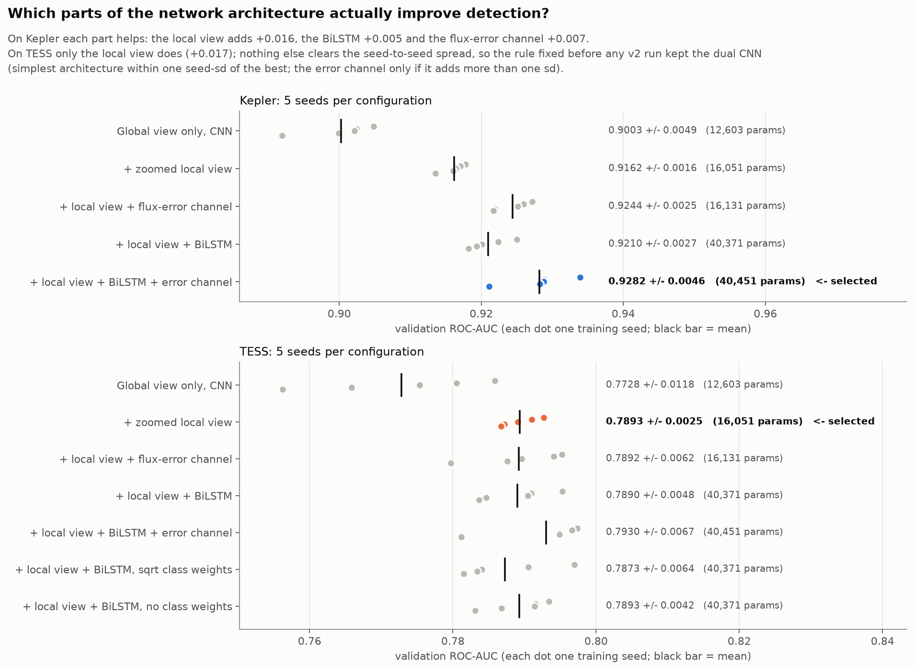
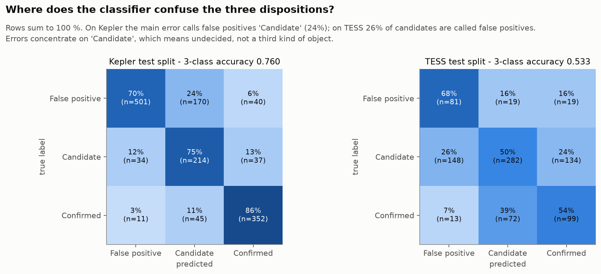
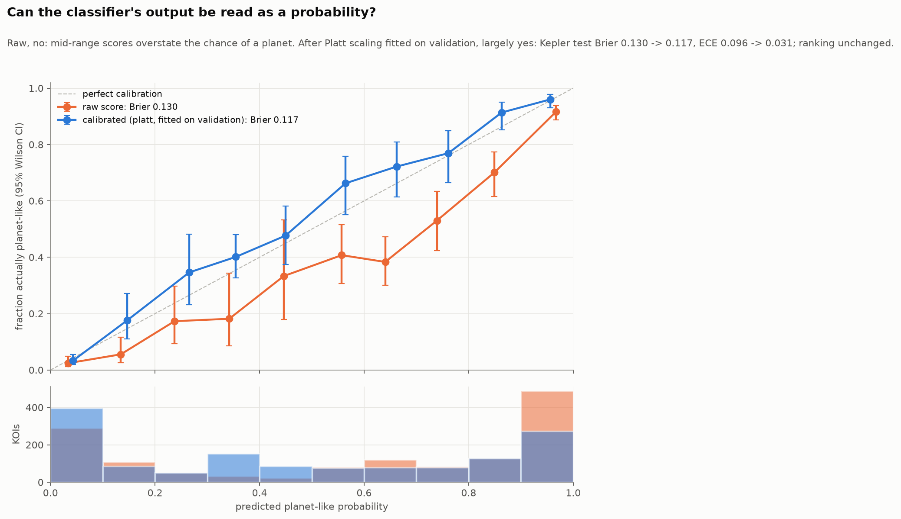
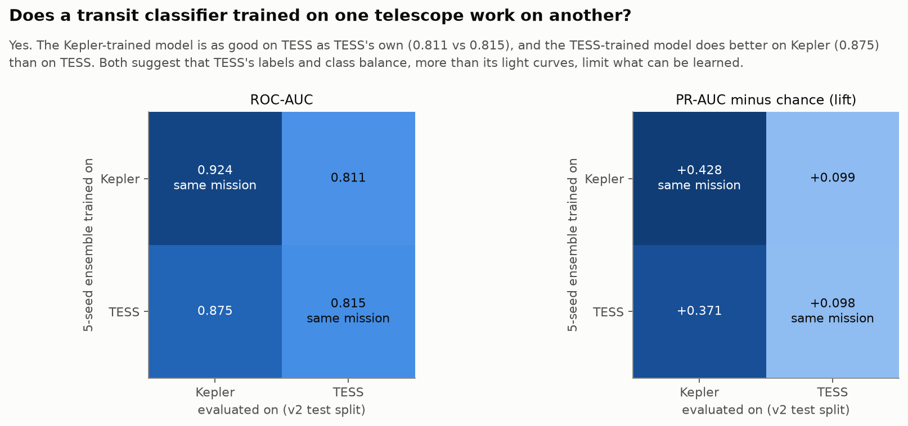
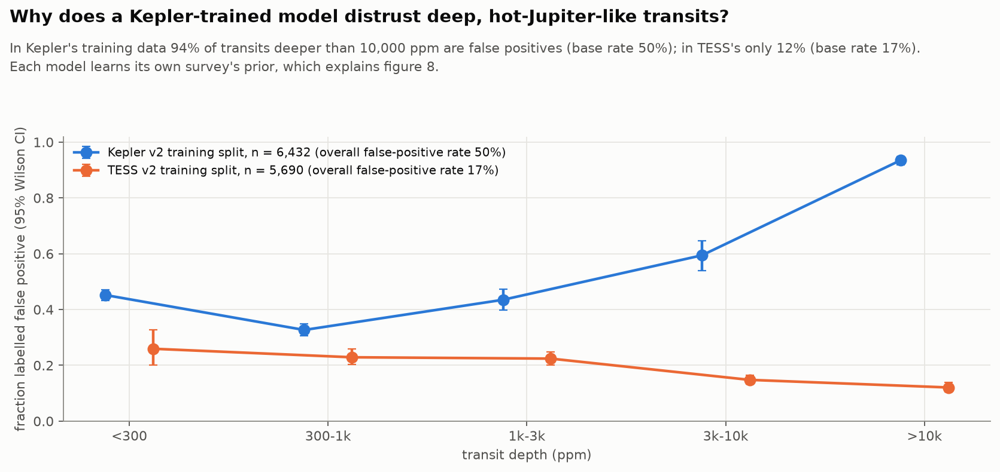
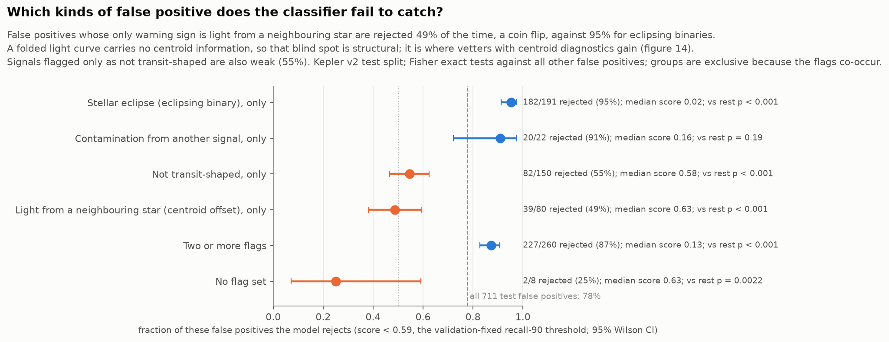
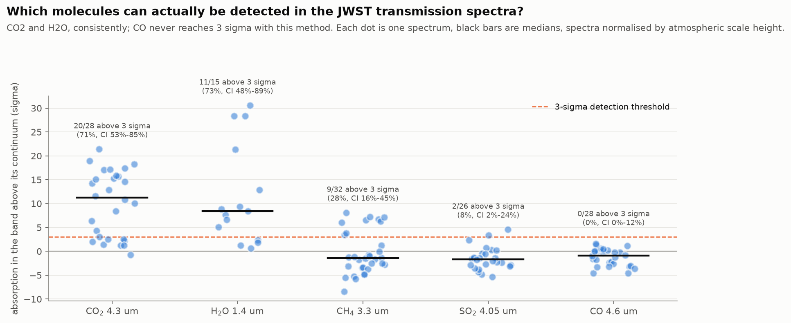
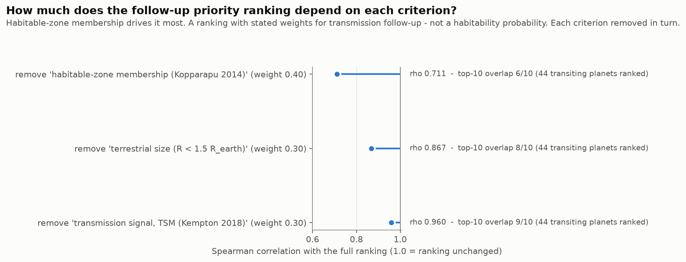

# Statistical figures

Every figure answers one question about the study. Figures 1–12 are regenerated from results
committed to this repository — no retraining, no downloads — by a single script:

```bash
python figures/make_figures.py                 # all of them
python figures/make_figures.py fig_injection   # just one
```

**Since 2026-10-18 the Stage A figures (1–10) show the final models on the leakage-free split v2:**
the 5-seed Kepler CNN+BiLSTM ensemble with the flux-error channel and the 5-seed TESS dual-CNN
ensemble, chosen on validation by a rule fixed before any v2 run, and read once on test
(`eda/STAGE_A_V2_FINAL_RESULTS.md`). Every number in a subtitle is computed from those saved results, so
the text cannot drift from the data. Earlier versions of these figures showed the single v1 models.

**Uncertainty is shown throughout.** ROC-AUC and PR-AUC carry 95 % bootstrap intervals that
resample *host stars* rather than rows, because several candidate signals share one star and are
not independent. Proportions carry 95 % Wilson score intervals. Model comparisons show every
training seed, so run-to-run noise is visible next to each difference.

| # | Question | Answer in one line |
|---|---|---|
| 1 | [How well does the classifier separate planets from false positives?](#1-how-well-does-the-transit-classifier-separate-real-planets-from-false-positives) | Kepler ROC-AUC 0.924 [0.909–0.937]; TESS 0.815 [0.777–0.853] |
| 2 | [Does a deep network beat simpler methods?](#2-does-a-deep-network-beat-simpler-methods-on-the-same-light-curves) | Yes: +0.034 (Kepler) and +0.094 (TESS) over boosted trees on shape features |
| 3 | [Which architecture parts improve detection?](#3-which-parts-of-the-network-architecture-actually-improve-detection) | On Kepler all three (local view, BiLSTM, error channel); on TESS only the local view |
| 4 | [Where does it confuse the three dispositions?](#4-where-does-the-classifier-confuse-the-three-dispositions) | Around "Candidate", the undecided class |
| 5 | [Can its output be read as a probability?](#5-can-the-classifiers-output-be-read-as-a-probability) | After Platt scaling fitted on validation, yes: test ECE 0.078 → 0.023 (Kepler), 0.144 → 0.018 (TESS) |
| 6 | [Does a model from one telescope work on another?](#6-does-a-transit-classifier-trained-on-one-telescope-work-on-another) | Yes: Kepler → TESS 0.811 vs TESS's own 0.815 |
| 7 | [Why does a Kepler model distrust deep transits?](#7-why-does-a-kepler-trained-model-distrust-deep-hot-jupiter-like-transits) | In Kepler's training data, 94 % of transits deeper than 10,000 ppm are false positives |
| 8 | [Are the two models biased toward different planets?](#8-are-the-two-detection-models-biased-toward-different-kinds-of-planet) | Yes, in opposite directions by planet size (ρ −0.37 vs +0.35) |
| 9 | [Which false positives does it fail to catch?](#9-which-kinds-of-false-positive-does-the-classifier-fail-to-catch) | Light from a neighbouring star: rejected 49 % of the time, vs 95 % for eclipsing binaries |
| 10 | [What is the shallowest detectable transit?](#10-what-is-the-shallowest-transit-the-classifier-can-actually-detect) | It responds reliably from about 40 ppm |
| 11 | [Which molecules are detectable in JWST spectra?](#11-which-molecules-can-actually-be-detected-in-the-jwst-transmission-spectra) | CO₂ and H₂O; never CO with this method |
| 12 | [What drives the planet priority ranking?](#12-how-much-does-the-follow-up-priority-ranking-depend-on-each-criterion) | Habitable-zone membership (without it ρ = 0.14) |
| 13 | Stage A final evaluation, one panel set | Made by `stage_a_transit_model/report_v2.py` |
| 14 | Against published vetters, same test KOIs | Ours 0.977 ≈ AstroNet 0.976 < ExoNet 0.990 < ExoMiner 0.996; made by `compare_published_vetters.py` |
| 15 | Does it work on a mission it never saw? (K2, pre-registered blind test) | Yes for ranking: ROC-AUC 0.863, confirmed vs FP 0.954. Its probabilities need recalibration. Made by `evaluate_k2.py` (`eda/K2_BLIND_TEST_RESULTS.md`) |
| 16 | Kepler DR25 simulated data: planets kept, false alarms rejected | Keeps more injected planets than the Robovetter (0.935 vs 0.869) but passes 24 % of systematics false alarms. Made by `evaluate_dr25_simulated.py` (`eda/DR25_SIMULATED_RESULTS.md`) |

---

## Detecting transiting planets

### 1. How well does the transit classifier separate real planets from false positives?

Measured once, on a test split with no host star and no signal twin shared with training. The TESS
precision-recall curve sits high only because 86 % of that test set is planet-like. The dotted lines
mark chance for each set, and the honest comparison is the height above them.
*Source:* `stage_a_transit_model/runs/v2_final/` (`*_test_predictions.csv`, `final_eval_v2.json`)

### 2. Does a deep network beat simpler methods on the same light curves?

Every method trains on the same v2 training split and is scored on the same test split. The single
seeds (mean 0.919 Kepler, 0.811 TESS) already beat the baselines; the ensemble adds about 0.005.
*Source:* `final_eval_v2.json` (`baselines`, `per_seed_test_roc_auc`)

### 3. Which parts of the network architecture actually improve detection?

Validation only: this is how the final architecture was chosen, before the test split was opened.
The rule was fixed in `sweep.py` before any v2 run. It picks the simplest architecture within one seed-sd of the best, then
adds the error channel only if it improves on the same architecture by more than one sd. Highlighted
dots are the selected configuration.
*Source:* `stage_a_transit_model/runs/v2_comparison.csv`

### 4. Where does the classifier confuse the three dispositions?

*Source:* `final_eval_v2.json` (`three_class`)

### 5. Can the classifier's output be read as a probability?

The ranking is good (figure 1) but the raw ensemble score is not a calibrated probability: the
Kepler ensemble overstates mid-range scores and the TESS ensemble understates them. A Platt map fitted
on **validation** only and carried to test unchanged brings the test ECE from 0.078 to 0.023 (Kepler)
and from 0.144 to 0.018 (TESS), and the Brier score from 0.120 to 0.110 and from 0.123 to 0.098. The
map is monotonic, so the ROC-AUC is unchanged.
*Source:* `v2_final/*_test_predictions.csv` (`calibrated_score`), `final_eval_v2.json` (`calibration`)

### 6. Does a transit classifier trained on one telescope work on another?

*Source:* `final_eval_v2.json` (`cross_mission`)

## Why the models behave as they do

### 7. Why does a Kepler-trained model distrust deep, hot-Jupiter-like transits?

*Source:* `splits/koi_cumulative_split_v2.csv`, `splits/toi_tess_candidates_split_v2.csv` (training rows)

### 8. Are the two detection models biased toward different kinds of planet?

Both ensembles scored the same 41 confirmed planets from their TESS light curves, so any difference
comes from the model, not the data. Grey lines join the two scores of one planet. The Kepler-trained
ensemble rejects canonical hot Jupiters (HD 189733 b 0.09, KELT-9 b 0.23), as figure 7 predicts.
*Source:* `outputs/stage_c/priority_target_scores_{KEPLER,TESS}_v2.csv`
(`stage_c_priority_fusion/score_priority_targets.py --with-errors --tag-suffix _v2 --runs …`)

### 9. Which kinds of false positive does the classifier fail to catch?

The 711 Kepler test false positives are grouped by which of Kepler's own false-positive flags they carry.
The groups are exclusive because the flags co-occur: most centroid-offset false positives also show an
eclipse or contamination signature that the light curve does carry. Counting flags one at a time hides the blind
spot, since centroid-offset false positives look just as common among the fooled ones (46 %) as among the rejected
(44 %). Isolated, those with **only** a centroid offset are rejected 49 % of the time, a coin flip,
against 95 % for eclipsing binaries. The threshold is the validation-fixed recall-90 operating point.
Reading the saved test predictions here changes no model and selects nothing.
*Source:* `v2_final/kepler_test_predictions.csv` + `koi_fpflag_*` from `splits/koi_cumulative_split_v2.csv`

### 10. What is the shallowest transit the classifier can actually detect?

Synthetic transits were injected into the real light curves of 50 v2 test stars before detrending,
and scored by the final 5-seed ensemble (400 injections). With nothing injected the ensemble already
scores a median 0.68, and 94 % of those folds pass the operating threshold. It is therefore a
**candidate vetter, not a blind transit search**: each injection is measured against the same star
with nothing added. The response is reliable from 40 ppm (the v1 single model needed about 80 ppm).
*Source:* `outputs/injection_recovery_v2/` (`stage_a_transit_model/injection_recovery.py --split-version v2 --runs …`)

## Atmospheres and target selection

### 11. Which molecules can actually be detected in the JWST transmission spectra?

*Source:* `outputs/stage_b_level2/band_indices.csv`

### 12. How much does the follow-up priority ranking depend on each criterion?

"Atmosphere retention only" keeps planet size in the score and drops only the cosmic-shoreline
factor (`eda/STAGE_C_RESULTS.md` §2b).
*Source:* `outputs/stage_c/ablation.csv`
